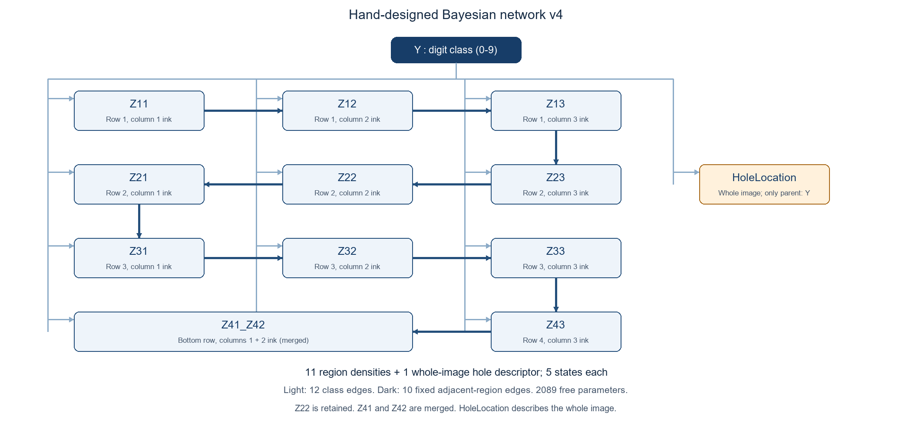
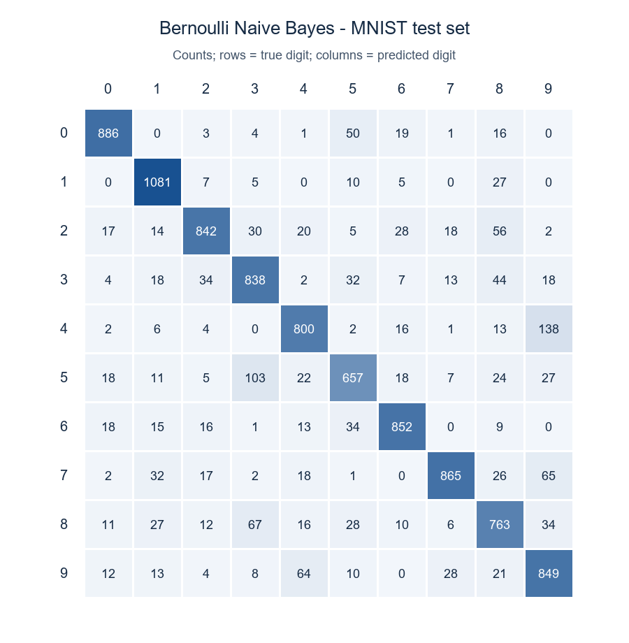
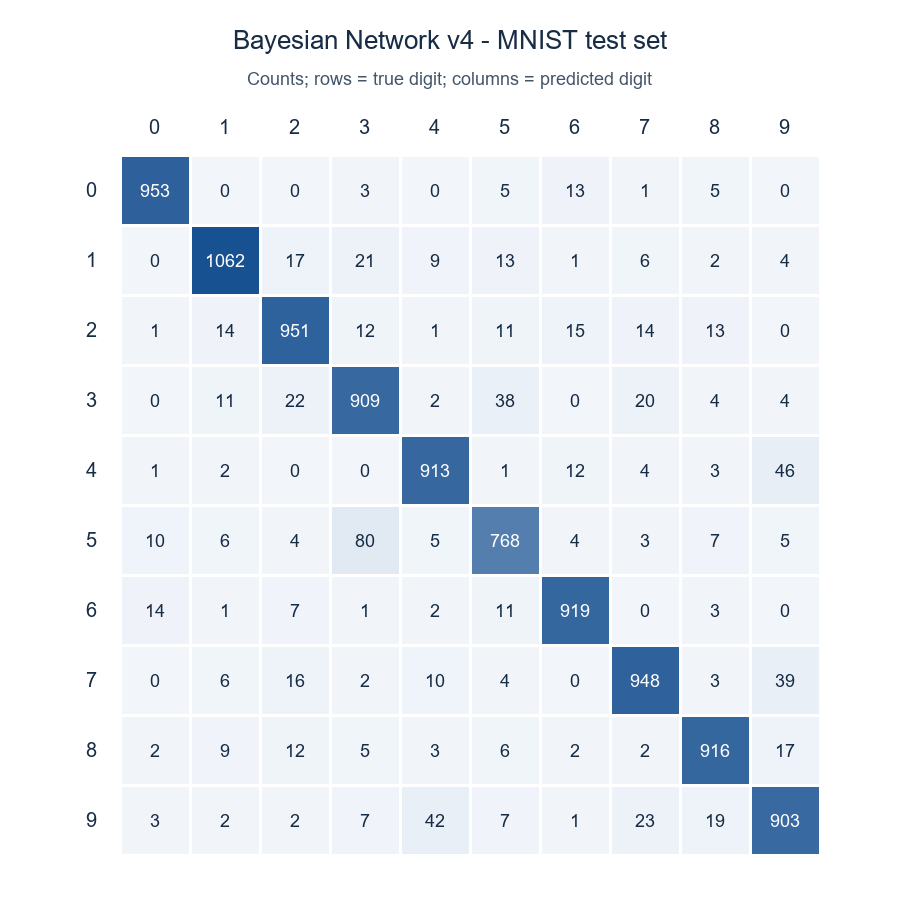
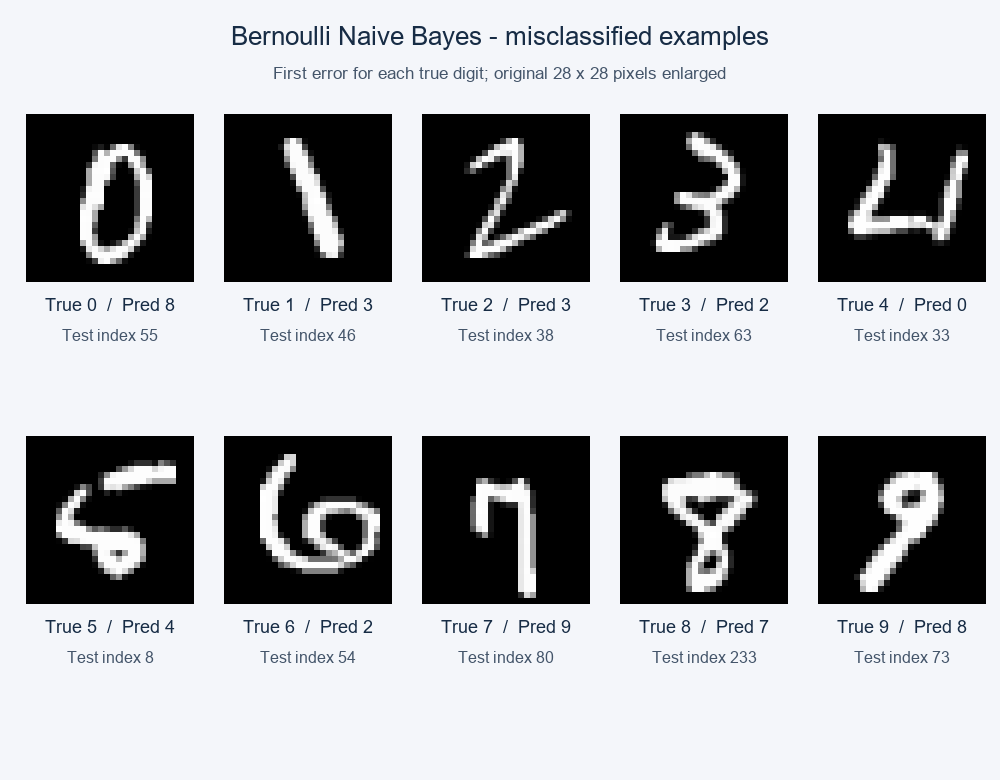
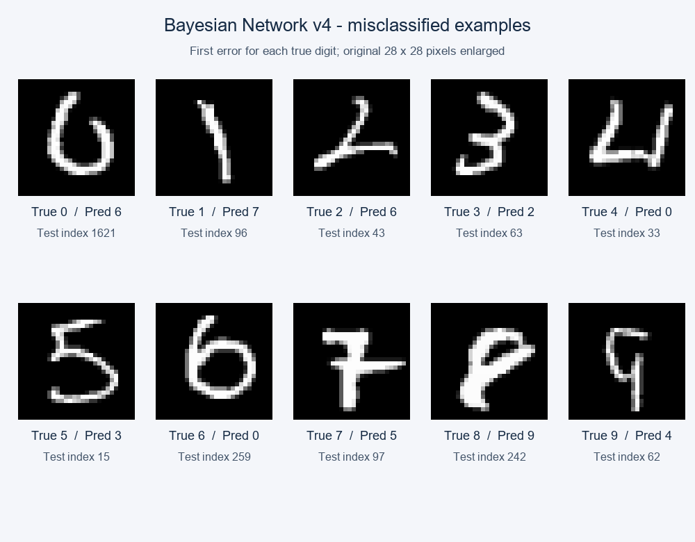

# MNIST 手写数字分类：朴素贝叶斯与手工贝叶斯网络

本作业从 28×28 灰度图像预测数字 0–9，自行实现两个概率分类器。朴素贝叶斯直接使用 784 个二值像素；手工贝叶斯网络使用 11 个区域墨量特征和 1 个闭环特征，并用少量特征间的边表示局部依赖。两个模型在完整 10,000 张测试图上的准确率分别为 **84.33%** 和 **92.42%**。

## 1. 数据、接口与总体思路

使用课程提供的标准 MNIST：训练集 60,000 张、测试集 10,000 张，像素取值 0–255。课程读取器负责读取 IDX 压缩文件；传入两个模型的图像均展平为 (n,784)。两个模型分别位于 [naive_bayes.py](naive_bayes.py) 和 [bayes_net.py](bayes_net.py)，均提供 fit(X,y) 和 predict(X)，手工网络另外提供 extract_features(X)。概率计数、平滑和预测由 NumPy 自行实现，没有调用现成分类器或自动结构学习程序。

两种模型的区别是如何表示图像。像素模型保留细节，但假设给定数字类别后各像素独立；手工网络把图像压缩成具有笔画含义的离散特征，再允许相邻区域存在条件依赖。两个模型均使用加一平滑（$\alpha=1$）；像素阈值为 128，网络的区域分档和闭环阈值在第 3 节说明。网络的特征和边由人工定义，设计过程中曾使用训练集内部验证比较候选方案；条件概率表只由训练样本估计。

## 2. 朴素贝叶斯：二值像素

对第 $j$ 个原始像素使用 $B_j=\mathbf{1}\{x_j>128\}$，记 $B=(B_1,\ldots,B_{784})$。因此灰度 128 属于背景，129 属于墨迹。给定类别 $Y=c$，模型近似认为 784 个 $B_j$ 条件独立：

$$
P(Y=c,B)=P(Y=c)\prod_{j=1}^{784}P(B_j\mid Y=c).
$$

由贝叶斯公式，$P(Y=c\mid B)=P(Y=c,B)/P(B)$。对于同一张待分类图片，分母 $P(B)$ 对所有类别相同，因此只需比较上式的联合概率，选择其最大的类别。

条件独立假设使估计简单，但同一笔画中的相邻像素实际上常一起变化。记 $N$ 为训练图片数，$N_c$ 为类别 $c$ 的图片数，$N_{cj}$ 为其中第 $j$ 个像素为墨迹的图片数。采用加一平滑（$\alpha=1$）：

$$
\hat P(Y=c)=\frac{N_c+\alpha}{N+10\alpha},\qquad
\theta_{cj}=\hat P(B_j=1\mid Y=c)=\frac{N_{cj}+\alpha}{N_c+2\alpha}.
$$

$P(B_j=0\mid Y=c)=1-\theta_{cj}$。类别先验的分母对应 10 类，像素概率的分母对应二值状态。预测时墨迹和背景都进入对数分数，避免大量概率连乘下溢：

$$
s_c(B)=\log\hat P(Y=c)+
\sum_{j=1}^{784}\left[B_j\log\theta_{cj}+(1-B_j)\log(1-\theta_{cj})\right],
\qquad \hat y=\arg\max_c s_c(B).
$$

模型的类别节点指向全部像素节点，像素之间没有边。实现按批次计算相同的对数分数；predict_proba 只是将这些分数归一化，不改变分类规则。

## 3. 手工贝叶斯网络：空间墨量与闭环

### 3.1 为什么这样提取特征

同一数字的平移、倾斜和大小变化会让固定位置的像素不一致。网络对每张图片单独做灰度质心校斜、前景裁剪，再缩放为 24×24。校斜由该图的灰度中心矩确定，斜率 $k=\mu_{xy}/\mu_{yy}$ 限制在 $[-1,1]$；裁剪以归一化灰度大于 0.1 的像素定位前景。高和宽分别缩放，因此区域位置更可比，但原始宽高比会丢失。这些步骤不读取类别标签，也不从整批图片估计预处理参数。

将 24×24 图像划成 4 行、3 列的 12 个 6×8 区域。令 $d_{rc}$ 为某区的灰度均值，$\bar d$ 为全部 12 区均值的平均，相对墨量 $r_{rc}=d_{rc}/\max(\bar d,10^{-6})$。它描述“该处比本张图的平均墨量多还是少”，减弱整图笔画深浅的影响；它不能直接表示笔画是否相连或朝哪个方向延伸。

课程限制最多 12 个特征。为了同时保留中心区域和闭环信息，网络保留 10 个原区域，将底行左、中两个相邻区域合成 Z41_Z42，得到 **11 个墨量特征 + 1 个闭环特征**。合并时先平均两个区域的连续灰度均值，再离散化；分母仍是原 12 个等面积区域形成的全图均值。这样保留第二行中央 Z22 的信息，但损失底部左、中两处的差异。下表对应归一化图像的空间位置；底行左、中是同一个合并特征。

| 行位置 | 左 | 中 | 右 |
| --- | --- | --- | --- |
| 第一行 | Z11 | Z12 | Z13 |
| 第二行 | Z21 | Z22 | Z23 |
| 第三行 | Z31 | Z32 | Z33 |
| 第四行 | Z41_Z42 | Z41_Z42 | Z43 |

| 特征 | 位置 | 它具体提供的线索 |
| --- | --- | --- |
| Z11 | 上左 | 左上起笔或顶部横笔左端是否明显。 |
| Z12 | 上中 | 顶部横笔、上弧或竖笔上端的墨量。 |
| Z13 | 上右 | 顶部横笔右端或上部右弧的墨量。 |
| Z23 | 中上右 | 上部右侧轮廓是否继续向下。 |
| Z22 | 中上中 | 穿过中心的竖笔、转折或收腰是否明显。 |
| Z21 | 中上左 | 左侧轮廓或折笔的墨量。 |
| Z31 | 中下左 | 下部左侧回弯或斜笔的墨量。 |
| Z32 | 中下中 | 竖干、斜笔或下环中部的墨量。 |
| Z33 | 中下右 | 下部右弧或收笔的墨量。 |
| Z43 | 底右 | 底部横笔右端或右下收尾的墨量。 |
| Z41_Z42 | 底左与底中 | 底横或下环左中部分的整体墨量，例如某些 2、6、8 的写法；无法再分别观察左右。 |

每个墨量特征按相对墨量分为 5 档，边界依次是 0.3、0.75、1.25、1.75，对应“很少、偏少、接近平均、偏多、很多”。等于边界时进入较高档。这些名称是对数值范围的解释，并非额外的规则分类器。

仅有墨量时，开口弧线与封闭轮廓可能很相似。因此第 12 个特征 HoleLocation 测量**洞的数量及单洞的纵向位置**。在 24×24 图上以灰度大于 0.4 为笔画，统计未与图像外部连通、面积至少 3 像素的四邻域背景连通块；5 个状态如下：

| 状态 | 含义 |
| ---: | --- |
| 0 | 没有有效洞 |
| 1 | 单洞位于上部：纵向质心 h<0.4 |
| 2 | 单洞位于中部：0.4≤h<0.6 |
| 3 | 单洞位于下部：h≥0.6 |
| 4 | 至少两个有效洞 |

其中 $h=(\text{洞像素平均行号}+0.5)/24$。上部单洞可为某些 9 提供线索，下部单洞可为某些 6 提供线索，双洞可为某些 8 提供线索；0、4 等写法也可能出现洞，所以模型不会用“有洞就判某个数字”的硬规则。阈值附近的细缝可能让洞消失或形成，这是特征的局限。

### 3.2 网络结构与每条边的含义

类别 Y 是根，分别指向上表的 11 个墨量特征及 HoleLocation：不同数字在每个位置的墨量以及闭环状态有不同分布。这样，Y 的 12 条边分别对应上表的 11 种位置线索和闭环线索。给定 Y 后，相邻格子仍可能共享同一段横笔、弧线或竖笔；因此 11 个墨量特征按空间相邻的蛇形顺序构成一条链：

**Z11 → Z12 → Z13 → Z23 → Z22 → Z21 → Z31 → Z32 → Z33 → Z43 → Z41_Z42**

| 特征边 | 建模理由 |
| --- | --- |
| Z11 → Z12 | 顶部横笔可从左上延伸到上中，两区墨量可能一起增大。 |
| Z12 → Z13 | 同一顶部横笔或上弧可继续延伸至右上。 |
| Z13 → Z23 | 右上弧线可能沿右侧向下延续。 |
| Z23 → Z22 | 上半部右侧的弧线或折笔可能进入中央。 |
| Z22 → Z21 | 中上部横笔或弧线可能从中央延伸到左侧。 |
| Z21 → Z31 | 左侧轮廓可能跨越中上、中下两行。 |
| Z31 → Z32 | 下部回弯、斜笔或横笔可能由左侧进入中央。 |
| Z32 → Z33 | 下部弧线或横笔可能从中央延伸到右侧。 |
| Z33 → Z43 | 右下笔画可能继续到底部右侧。 |
| Z43 → Z41_Z42 | 底部横笔或弧线可能连接底右与合并后的底部左中区域。 |

箭头规定条件概率的分解顺序，**不表示真实书写顺序或因果方向**。例如 Z11→Z12 表示估计 Z12 时同时考虑数字类别和 Z11 的墨量档位。HoleLocation 只有 Y 一个父节点：这保持网络小而易解释，但近似地忽略了闭环与局部墨量间的部分依赖。每个特征最多有 Y 和一个区域父节点，图中无环，也没有隐藏变量或自动学习出的边。

图中浅色箭头是 Y 到 12 个特征的边，深色箭头是表中逐条说明的 10 条相邻区域边。

### 3.3 训练概率表与预测

全部特征可由图片直接观察。记 $F_j$ 为第 $j$ 个特征，$\pi_j$ 为它的区域父节点；没有区域父节点时省略 $F_{\pi_j}$。联合概率分解为：

$$
P(Y,F_1,\ldots,F_{12})=P(Y)\prod_{j=1}^{12}P(F_j\mid Y,F_{\pi_j}).
$$

它与朴素贝叶斯一样用类别先验和观测特征的条件概率按贝叶斯准则分类，但条件独立假设不同：朴素贝叶斯给定 $Y$ 后把像素分别计入似然；本网络给定 $Y$ 后仍让相邻区域的墨量通过特征边相互条件化。两者的输入特征也不同，因此测试准确率之差不能单独衡量网络边的作用。

对每个类别 c、父状态 u 和当前特征状态 s，用训练频数估计 CPT，并对 5 个状态加一平滑：

$$
\hat P(F_j=s\mid Y=c,F_{\pi_j}=u)=
\frac{N_{c,u,s}+\alpha}{N_{c,u}+5\alpha},\qquad \alpha=1.
$$

类别先验同样使用加一平滑；没有区域父节点时只按类别计数。预测时对 10 个类别分别累加对数先验与 12 项对数条件概率，取最大者。Z11 和 HoleLocation 的 CPT 形状为 (10,5)，其余 10 个为 (10,5,5)。模型共 13 个节点、22 条边、2,089 个自由参数；这些概率来自训练样本，不是人工填写的类别规则。

## 4. 完整测试结果与误差分析

两个模型均用全部 60,000 张训练图估计概率，在完整的 10,000 张标准测试图上评估。Macro Precision、Macro Recall 和 Macro F1 是先按数字类别计算，再对 10 类取平均；Macro F1 不是前两个宏平均值的调和平均。

| 模型 | Accuracy | Macro Precision | Macro Recall | Macro F1 | 正确张数 |
| --- | ---: | ---: | ---: | ---: | ---: |
| 朴素贝叶斯 | 84.3300% | 84.4144% | 84.0890% | 84.1613% | 8,433 |
| 手工贝叶斯网络 | **92.4200%** | **92.3842%** | **92.3723%** | **92.3726%** | **9,242** |

手工网络比像素朴素贝叶斯多判对 809 张，提高 8.09 个百分点。但两者既改变了输入特征，也改变了依赖假设；这项对比不能单独证明某条边或某个特征造成了提升。

下图均以**行表示真实类别、列表示预测类别**，单元格是样本数。

朴素贝叶斯最常见的双向混淆包括 4/9（202 张）、3/5（135 张）；手工网络中仍有 3/5（118 张）、4/9（88 张）和 7/9（62 张）。数字 5 在手工网络中的召回率最低，为 86.10%。3 和 5 都可能有上部转折与下部弧线；4 与 9 可能出现相似的上部交叉或闭合形状。这些是基于图像形态的解释，不是仅凭混淆矩阵就能证明的错误原因。

误分类图中，每个真实数字取测试集顺序中的第一张误判图片；下表选出 5 张说明特征的能力边界。图片保持原始灰度，预测仍使用模型规定的预处理。

| 测试索引 | 真实 → 网络预测 | 可能原因 |
| ---: | --- | --- |
| 1621 | 0 → 6 | 顶部开口，单靠区域墨量和洞状态难稳定区分 0 与带短上笔的 6。 |
| 43 | 2 → 6 | 下方斜笔与横笔相接，区域墨量保留位置但不直接表示笔画方向。 |
| 15 | 5 → 3 | 上横笔仍像 5，但右上墨量偏少、下半弧偏向右侧，左下和中下区域接近空白。网络记录到 Z13=1、Z31=Z32=0，这些区域概率项更支持 3；无洞状态几乎不能区分两类。 |
| 259 | 6 → 0 | 大回环与较短的上延笔使整体形状接近 0。 |
| 242 | 8 → 9 | 下部环较粗，洞状态可能不足以稳定表达双环。 |

以索引 15 为例，在已观察到上中区域 Z12=4 的条件下，右上低墨量状态 Z13=1 的 CPT 概率对数字 3 约为 0.418、对数字 5 约为 0.090。左下与中下的空白状态也偏向 3；上横笔仍提供支持 5 的线索，但未抵消这些项。这里描述的是该模型的实际概率贡献，不表示这些区域单独决定了误判。

## 5. 讨论与反思

**怎样让手工特征既可解释又有区分力？** 起初，较粗的区域密度和对称性分档虽容易说明，却使不少样本集中在同一状态；某些 CPT 父状态组合很少出现。加一平滑只能防止零概率，无法恢复被粗特征丢掉的笔画位置。处理办法是把图像划为 4×3 个小区域，使用相对墨量和五档状态，使上、中、下以及左右笔画的差异更明确。代价是区域均值仍不记录笔画的精确形状。

**怎样减少书写位置和倾斜的影响，又不过度改变字形？** 同一数字的大小、平移和倾斜会使笔画落入不同区域。因此模型按每张图自己的灰度质心校斜，裁剪前景并缩放到统一尺寸，而不从标签或整个数据批次估计变换参数。这使区域位置更可比，却也带来取舍：高宽分别缩放会丢失原始宽高比，紧裁剪和较强校斜可能损伤边缘笔画。几何处理不能保证所有非典型写法都被对齐。

**怎样在特征数量限制下补充闭环信息？** 仅用区域墨量难以区分开口弧线和封闭轮廓，所以增加洞的数量与纵向位置特征。为减少孤立空隙的干扰，闭环提取规定了前景阈值、四邻域背景连通方式和最小洞面积。不过细缝经插值或二值化后可能开合，同一类数字的洞状态仍会跳变。课程最多允许 12 个特征，因此把底部左、中两个相邻区域合并，保留中上部 Z22 和闭环信息；这样又失去了分别观察底部左、中笔画的能力。

**怎样表达特征依赖而不让 CPT 过于稀疏？** 同一笔画可能跨越相邻区域，完全假定它们条件独立过于粗糙；若给每个特征增加多个父节点，CPT 的条件组合会迅速增多，少见组合只能主要依靠平滑。当前选择一条相邻区域链，每个区域最多再有一个区域父节点，并让闭环只以类别为父节点。这满足小型 DAG 的约束，也保留了可解释的局部依赖，但不能表达所有跨区域关系；闭环与局部墨量之间的真实关联也未被显式建模。

**还有哪些错误没有解决？** 3/5 等混淆说明相对墨量和洞状态仍不能直接表达笔画方向、端点、交点和开口方向。朴素贝叶斯也受像素条件独立假设及二值化丢失灰度信息的限制。两个模型输出的后验都未经概率校准；当前整体成绩不能证明单个特征或某条边各自的贡献。若继续改进，应先提出少量有明确笔画意义的开口或端点特征，并检查闭环检测在细缝附近的稳定性，同时维持足够的 CPT 样本量；设计比较应限于训练集内部，避免根据测试集错误反复修改。

### 朴素贝叶斯的局限性

同一条笔画上的相邻像素往往一起出现，但朴素贝叶斯把它们视为给定类别后的独立证据，可能重复计算同一形状信息。固定像素位置还使模型对平移、倾斜和笔画粗细敏感；阈值 128 将不同灰度的细笔画压成相同的二值状态。加一平滑解决的是零概率，不能修正这些表示和独立性问题。这有助于理解其 4/9、3/5 等混淆，但不能仅凭误判频数断定每张图的具体原因。

### 贝叶斯网络结构设计的挑战

网络需要在“特征足够表达数字形状”和“CPT 有足够样本可估计”之间平衡。12 个特征名额迫使区域信息与闭环信息作取舍；每增加一个五值父节点，相关 CPT 就要区分更多条件组合。相邻链用较少参数描述局部关联，但蛇形箭头只是概率分解顺序，并非真实的书写因果关系，也会遗漏不相邻区域间的依赖。因此，网络结构合理不等于每条边都已被证明必要。

### 若继续改进

先从笔画含义出发，事先限定少量候选，例如用一个开口方向或端点位置特征替换信息较少的区域特征，并检查不同笔画粗细、细缝下闭环状态是否稳定。比较时保持其余预处理和 CPT 估计方式一致；另用相同特征、去掉特征间边的对照，区分特征提取与网络依赖各自的作用。只在训练集内部的固定划分上检验这些设想，确定设计后用全部训练样本重估 CPT，不根据已查看的测试集误判继续挑选阈值或边。

## 6. 核验与复现

共 15 项单元检查通过，包含手算概率与平滑、对数分数、离散边界、区域顺序、合成图中的单洞与双洞，以及空输入和非法输入。运行入口为 [main.py](main.py)；在项目根目录执行 python assignment2/main.py 可重新生成两个模型的指标与图。课程原始数据和实验缓存已由 Git 忽略，不应随作业提交。

依据：课程讲义《Handwritten Digits Classification (Assignment - 2).pdf》、课程 MNIST 数据说明与读取器。图像和标签来自课程提供的数据。
