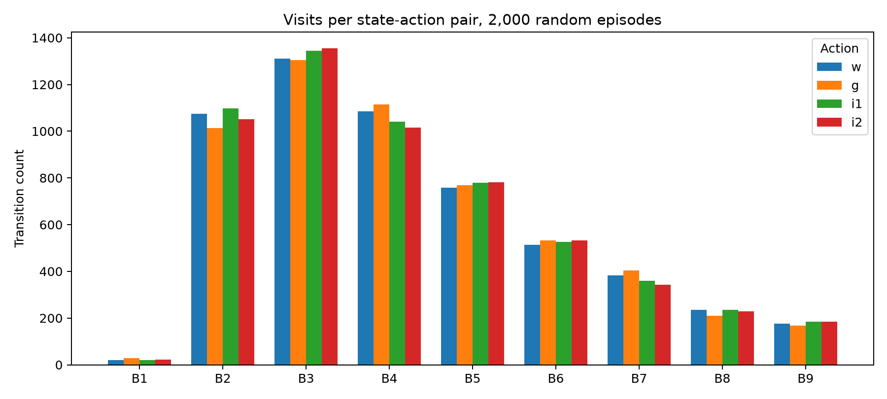
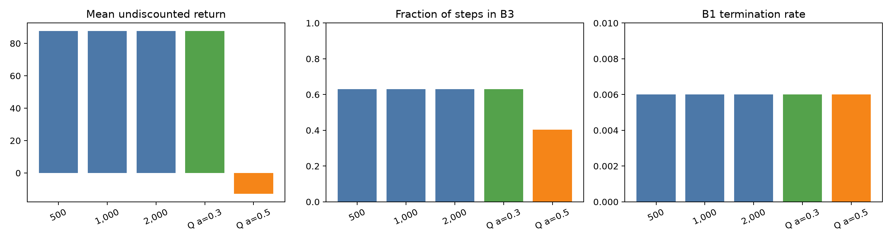
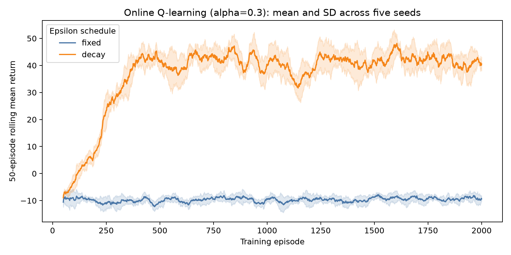

# 血糖调控智能体：经验模型与 Q-Learning 对比

## 1. 总体设计与复现

两种方法使用同一批均匀随机交互数据：2,000 条 episode，共 22,204 条 $(s,a,r,s',\mathrm{done})$。这是 `main.py` 自行采集的本地数据，两种方法共享这一批数据。Part A 先用数据拟合经验转移分布和奖励均值，再对经验模型做同步价值迭代；Part B 在构造时显式设置学习率 $\alpha=0.3$，完全按原始顺序回放同一批数据，直接更新表格 Q 值；类的默认参数仍为讲义接口中的 0.5。两者均不读取模拟器内部的真实转移规律或奖励表，也未使用现成强化学习或规划库。`model_based.py` 与 `q_learning.py` 是评分接口；`main.py` 负责数据采集、评估和全部图表。

在包含 `assignment3/`、课程提供的 `glucose_env.py` 和 `sanity_check.py` 的目录运行：

```bash
python -m pip install -r assignment3/requirements.txt
python sanity_check.py
python assignment3/main.py
```

`main.py` 会打印全部数值并重新生成 `figures/` 下的三张图。数据集动作抽样器种子为 2026，第 $i$ 条训练轨迹的环境种子为 $2026+i$；500 条评估轨迹使用 $300000+i$；这组种子与选择学习率时的预试验评估种子分开。评估两种策略以及三个消融模型时复用相同的 500 个环境种子。平均回报是每条轨迹奖励的**无折扣**总和再取均值；B3 时间比例是所有评估轨迹中，动作后进入 B3 的步数除以总步数；B1 终止率是因进入 B1 而结束的轨迹比例。达到 200 步的正常结束不计为 B1 终止。

## 2. Part A：估计模型并规划

对每个状态—动作对 $(s,a)$ 计数 $N(s,a)$，对后继状态计数 $N(s,a,s')$，并累计所见奖励。经验模型为

$$
\hat P(s'\mid s,a)=\frac{N(s,a,s')}{N(s,a)}.
$$

$$
\hat R(s,a)=\frac{\sum_{i:(s_i,a_i)=(s,a)}r_i}{N(s,a)}.
$$

未访问的 $(s,a)$ 使用对九个状态的均匀转移分布和零奖励；这样接口始终有合法概率分布，且不会凭空偏向某个后继状态或动作。零样本模型只是占位默认值，不能解读为真实环境估计。

价值迭代从全零价值开始，每轮用上一轮完整价值表同步计算

$$
V_{k+1}(s)=\max_a\left[\hat R(s,a)+\gamma\sum_{s'}\hat P(s'\mid s,a)V_k(s')\right],\qquad \gamma=0.9.
$$

当最大状态价值变化小于 $10^{-4}$ 或达到 1,000 轮时停止，策略按动作输入顺序取最大值，平局取第一个。这里严格采用作业指定的 $\hat P/\hat R$ Bellman 形式；模型没有另外估计 `done` 的条件分布。



图 1：每个状态动作对的访问次数。B3 的四个动作各有 1,304–1,356 次，B1 仅 20–29 次，B9 仅 167–185 次；靠两端的状态较稀疏。B1 偶尔由 `reset()` 给出，因此虽然转移进入 B1 会终止，数据里仍有 B1 作为当前状态的动作记录。

| 状态 | 模型策略 π(s) | V̂(s) |
|---|:---:|---:|
| B1 | g | 0.099 |
| B2 | g | 3.838 |
| B3 | w | 4.590 |
| B4 | i1 | 4.256 |
| B5 | i2 | 3.613 |
| B6 | i2 | 2.114 |
| B7 | i2 | 0.021 |
| B8 | i2 | -3.807 |
| B9 | i2 | -9.210 |

B4 提供了一个直观例子：经验模型给 `i1` 的规划动作值约 4.256，给 `w` 的约 3.478，给 `i2` 的约 3.653，所以选择小剂量胰岛素。它在 B4 的经验转移和即刻奖励之间取得较高的折扣后价值；选择不是仅按动作成本决定。B1 的策略和值主要反映极少数“初始状态就是 B1”的样本，不代表进入 B1 后还会继续行动。

### 数据量消融

分别用同一数据集的前 500、1,000、2,000 条 episode 独立重新估计模型和规划，评估使用同样 500 个种子。

| 训练 episode 数 | 平均无折扣回报 | B3 步数比例 | B1 终止率 |
|---:|---:|---:|---:|
| 500 | 87.538 | 63.064% | 0.6% |
| 1,000 | 87.538 | 63.064% | 0.6% |
| 2,000 | 87.538 | 63.064% | 0.6% |

三个样本量恰好得到完全相同的九状态策略，故在固定评估种子上得到完全相同的结果；这不表示模型参数也相同。相对于 2,000 条版本，500 条版本各 $(s,a)$ 经验转移分布的平均总变差距离为 0.060，平均奖励绝对差为 0.263；1,000 条版本分别降至 0.035 和 0.156。这个对比仅以 2,000 条估计作为参照，不是真实模型误差或性能置信区间。1,000 条版本更接近本次 2,000 条参照，但是否跨不同数据集更稳定，还需多随机种子验证；本次动作排序没有跨过决策边界。

## 3. Part B：离线 Q-Learning

Q 表全部初始化为零。本报告的离线主实验使用 $\alpha=0.3$，对每条 episode 中每条转移按提供顺序执行

$$
Q(s,a)\leftarrow Q(s,a)+\alpha\left[\mathrm{target}-Q(s,a)\right],\qquad \alpha=0.3.
$$

若 `done=True`，则 $\mathrm{target}=r$；否则 $\mathrm{target}=r+\gamma\max_{a'}Q(s',a')$，其中 $\gamma=0.9$。`learn()` 不做动作抽样，也不使用 `mode` 决定探索。贪心策略在并列时同样按动作输入顺序取第一个。

| 状态 | Q(w) | Q(g) | Q(i1) | Q(i2) | 贪心动作 |
|---|---:|---:|---:|---:|:---:|
| B1 | 0.648 | 1.813 | -8.871 | -10.397 | g |
| B2 | 2.511 | 3.999 | -6.222 | -5.054 | g |
| B3 | 4.653 | 4.626 | 3.447 | -0.214 | w |
| B4 | 4.358 | 1.882 | 5.133 | 2.623 | i1 |
| B5 | 2.553 | 0.974 | 3.867 | 4.464 | i2 |
| B6 | -0.143 | -1.236 | 2.100 | 3.261 | i2 |
| B7 | -4.094 | -10.044 | -0.163 | 1.842 | i2 |
| B8 | -6.786 | -13.920 | -7.378 | -4.148 | i2 |
| B9 | -16.680 | -16.407 | -13.590 | -8.514 | i2 |

### 与 Part A 的同预算对比

只计非终止状态 B2–B9，模型法与主实验 Q-Learning（$\alpha=0.3$）在 **8/8 个状态一致，即 100%**。两者的 Q 值估计仍不同：在 B3，模型规划动作值中 `w` 约为 4.590、`g` 约为 3.445；Q 表中 `w` 约为 4.653、`g` 约为 4.626，仅相差 0.027。相同的贪心策略在相同评估种子上产生完全相同的指标，但不能据此认为两个估计过程相同。



图 2：前三组是模型法的样本量消融，后两组分别是 $\alpha=0.3$ 的 Q-Learning 主实验和默认 $\alpha=0.5$ 的附加敏感性对照。B1 终止率图使用较小纵轴范围，以显示各组共同的 0.6%。

| 方法 | 平均无折扣回报 | B3 步数比例 | B1 终止率 |
|---|---:|---:|---:|
| 模型法，2,000 条 | 87.538 | 63.064% | 0.6% |
| 离线 Q-Learning，α=0.3 | 87.538 | 63.064% | 0.6% |
| 附加对照：Q-Learning，α=0.5 | -12.765 | 40.366% | 0.6% |

模型法与 $\alpha=0.3$ 的 Q 策略在九个状态上的动作完全相同，因此三项评估指标也相同。两者均有 500 条中 3 条因进入 B1 而终止；事件数仍不足以判断安全性差异。作为附加敏感性对照，使用讲义接口的默认 $\alpha=0.5$ 在同一数据上使 B3 改选 `g`，其他状态动作不变；相对主实验，平均回报降低约 100.303，B3 时间比例降低约 22.699 个百分点。固定学习率下的直接 Q 估计会受样本顺序与近期奖励影响，B3 的粗分箱也可能放大动作排序的变化；一次数据集不能证明某个学习率普遍更优。

### 附加在线探索实验

从零初始化另训 Q-Learning（学习率同样为 $\alpha=0.3$），分别使用固定 $\varepsilon=0.3$ 与按 episode 衰减的 $\varepsilon\leftarrow\max(0.05,0.995\varepsilon)$（初始 0.3）。每种设置运行五个独立种子，每个种子 2,000 条训练轨迹；同编号种子、同编号 episode 的环境种子在两种设置间相同。每条轨迹的无折扣回报先做 50 条滑动均值，再对五个种子求均值；浅色带表示种子间标准差。该实验与离线主任务分开，不改变主任务的 Q 表。



图 3：衰减探索的训练回报在前约 350 条轨迹逐步提高，随后主要在 35–45 附近波动；固定探索率曲线长期在约 -10 附近。最后一个 50 条窗口的五种子均值分别约为 **40.54**（衰减）与 **-9.39**（固定），最终探索率分别为 0.05 与 0.3。从第 9 章探索代价（Regret）的角度看，固定探索持续执行随机动作，可能增加动作成本并使血糖离开目标区间，累积回报因此受损。图中两条训练回报曲线的差距不能直接当作严格定义的 Regret：两组也学到了可能不同的策略。若要单独比较学习质量，需要定期关闭探索并评估贪心策略；训练回报曲线本身不能证明哪一种最终策略最优。

## 4. 收敛条件、局限与反思

第 9 章的充分访问条件在有限离线数据中不能严格保证：随机策略覆盖了全部 36 个 $(s,a)$，但 B1、B9 明显比 B3 稀疏；在线衰减策略也可能逐渐少访问非贪心动作。Q-Learning 主实验的固定 $\alpha=0.3$ 不满足通常收敛定理所需的逐步减小学习率及相应求和条件，因此本报告只陈述有限样本结果，不宣称 Q 值收敛。$\gamma=0.9<1$，模拟器奖励和动作成本有界，满足折扣与有界奖励条件。

最大的困难是有限状态抽象：状态名只保留血糖区间，模拟器内部还有连续血糖和进餐余效，同一 B3 在不同历史下的后续转移可能不同。因此经验 $\hat P(s'\mid s,a)$ 是数据分布下的平均，而固定学习率的 Q 更新也可能被后期轨迹带偏。另一个限制是作业指定的模型只存储 $\hat P(s'\mid s,a)$ 和 $\hat R(s,a)$，没有单独存储终止概率；进入 B1 时环境会终止，但 Bellman 规划式仍会使用估计的 B1 价值。这个边界效应使数值价值不应被解释为精确的真实回报，且此模拟结果不构成临床建议。

当状态和动作数少、模型能较准确估计且反复规划时，模型法通常更划算；若环境机制复杂、状态抽象难以形成可靠转移表，直接从交互经验估计动作价值更省建模步骤，但固定学习率和数据顺序需要谨慎处理。进一步工作可检查多数据集种子和置信区间，比较逐步下降学习率，并在允许更丰富观测时采用函数逼近；也可把终止事件纳入扩展经验模型，再与本作业规定的简化模型作对照。

**资料来源：** 本作业讲义，以及随作业提供的 `glucose_env.py`、`sanity_check.py`。未引用第三方文献或公开课程的作业代码。
